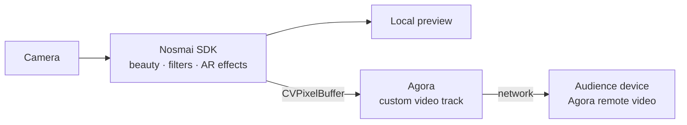

# Nosmai × Agora — iOS Live Streaming Quickstart

A minimal iOS sample that shows how to broadcast a live stream with **Nosmai** beauty, filters and AR effects over the **Agora Video SDK**.

Nosmai runs the camera and renders the effects on the host's device. Each processed frame is handed to Agora as a custom video source, so viewers receive exactly what the host sees — no extra work is needed on the audience side.


## Features

- **Go live as a host** with the Nosmai camera and effects pipeline
- **Watch as an audience member** on a second device
- **Beauty controls** — skin smoothing, whitening, face slimming, eye enlargement, sharpening
- **Cloud filters and AR effects** — browsed with thumbnails, downloaded on demand, applied in one tap
- **Front / back camera switch**
- **Live FPS counter** for both host (frames sent) and audience (frames rendered)

## How it works



1. Agora is configured to take video from an external source instead of its own camera capture.
2. Nosmai is initialised with your API key, attached to the preview view, and starts the camera.
3. Nosmai delivers every processed frame through `liveFrameStreamCallback`. The app wraps the `CVPixelBuffer` in an `AgoraVideoFrame` and pushes it to Agora.
4. The audience joins the same channel as a regular Agora subscriber.

## Requirements

| | |
|---|---|
| Xcode | 15 or later |
| iOS | 15.0 or later |
| Dependency manager | [CocoaPods](https://cocoapods.org) |
| Devices | Two physical iPhones — one to host, one to watch. The camera is not available in the simulator. |
| Accounts | A Nosmai API key and an [Agora](https://console.agora.io) project |

## Getting started

### 1. Clone and install

```sh
git clone https://github.com/HashirYamin-dev/quick-start-nosmai-agora-livestreaming-app.git
cd quick-start-nosmai-agora-livestreaming-app
pod install
```

Open **`NosmaiAgoraDemo.xcworkspace`** in Xcode (not the `.xcodeproj`).

### 2. Set your bundle identifier

In the target's **Signing & Capabilities** tab, select your team and set your own bundle identifier.

> **Important:** a Nosmai API key only works with the bundle identifier it was issued for. Create your key for the same bundle identifier you set here.

### 3. Get your keys

- **Nosmai** — create an API key for your bundle identifier in the Nosmai dashboard.
- **Agora** — create a project in the [Agora Console](https://console.agora.io) and copy its **App ID**. If the project has an App Certificate enabled, also generate a **temporary token** for the channel name you plan to use.

### 4. Add the keys

Open `NosmaiAgoraDemo/DemoConfig.swift` and replace the placeholders:

```swift
static let nosmaiAPIKey = "YOUR_NOSMAI_API_KEY"
static let agoraAppID   = "YOUR_AGORA_APP_ID"
static let agoraChannel = "demo-channel"
static let agoraToken   = "YOUR_AGORA_TEMP_TOKEN"
```

| Value | Description |
|---|---|
| `nosmaiAPIKey` | Your Nosmai API key. |
| `agoraAppID` | The 32-character App ID of your Agora project. |
| `agoraChannel` | Any channel name. Host and audience must use the same one, and it must match the channel the token was generated for. |
| `agoraToken` | Temporary token from the Agora Console. Leave it as an empty string if your project has no App Certificate. |

### 5. Run

Build and run on both iPhones.

1. On the first phone tap **Go Live (Host)** and allow camera and microphone access.
2. On the second phone tap **Watch (Audience)**.
3. On the host, use the **Beauty**, **Filters** and **AR Effects** tabs — the audience sees the result in real time.

## Project structure

```
NosmaiAgoraDemo/
├── DemoConfig.swift          Your keys and channel name
├── HomeViewController.swift  Role selection: host or audience
├── LiveViewController.swift  Nosmai camera + Agora channel (the integration)
├── EffectsPanelView.swift    Beauty sliders, cloud filters and AR effects UI
├── AppDelegate.swift         App and scene setup
└── NosmaiAgoraDemo-Bridging-Header.h   Exposes the Nosmai framework to Swift
```

## Integration walkthrough

All of the code below is taken from `LiveViewController.swift`.

**Tell Agora that video comes from your app** — this must happen before joining the channel:

```swift
engine.setExternalVideoSource(true, useTexture: true, sourceType: .videoFrame)
```

**Join as a host publishing a custom video track:**

```swift
let options = AgoraRtcChannelMediaOptions()
options.clientRoleType = .broadcaster
options.publishCameraTrack = false
options.publishCustomVideoTrack = true
options.publishMicrophoneTrack = true
rtc.joinChannel(byToken: token, channelId: channel, uid: 0, mediaOptions: options)
```

**Start Nosmai and show the local preview:**

```swift
NosmaiCore.shared().initialize(withAPIKey: apiKey) { success, error in
    guard success, let camera = NosmaiCore.shared().camera else { return }
    camera.attach(to: previewView)
    camera.startCapture()
    NosmaiSDK.sharedInstance()?.startProcessing()
}
```

**Forward every processed frame to Agora:**

```swift
NosmaiCore.shared().liveFrameStreamCallback = { pixelBuffer, timestamp in
    let frame = AgoraVideoFrame()
    frame.format = 12 // CVPixelBuffer
    frame.textureBuf = pixelBuffer
    frame.time = CMTime(seconds: timestamp, preferredTimescale: 1000)
    rtc.pushExternalVideoFrame(frame, videoTrackId: 0)
}
```

**Apply effects** (`EffectsPanelView.swift`) — anything applied here is part of the frames sent to Agora:

```swift
let effects = NosmaiCore.shared().effects

// Beauty: values range from 0.0 to 1.0
effects?.applySkinSmoothing(0.6)
effects?.applyFaceSlimming(0.3)

// Cloud filters and AR effects
effects?.downloadCloudFilter(filterId, progress: nil) { success, _, _ in
    if success { effects?.applyCloudFilter(filterId, completion: nil) }
}
```

When listing cloud filters with `getCloudFilters(with:completion:)`, use each item's `filterId` value to download and apply it.

## Troubleshooting

| Symptom | Likely cause |
|---|---|
| The home screen says a key is not set | A placeholder is still present in `DemoConfig.swift`. |
| `Nosmai init failed` | The API key is wrong, or the app's bundle identifier does not match the one the key was issued for. |
| `Agora error 110`, or the join fails | The token is invalid, expired, or was generated for a different channel name. Temporary tokens are valid for 24 hours. |
| The audience stays on "waiting for host" | The two devices are using different App IDs or channel names, or the host has not gone live yet. |
| A tab shows "not enabled for this Nosmai license" | Beauty or cloud filters are not part of your Nosmai plan. |
| A filter fails to download | The filter is not included in your Nosmai plan, or the device is offline. |
| Build fails with a missing `Pods` error | Run `pod install` and open the `.xcworkspace`. |

## Going to production

This sample is intentionally small. Before shipping your own app:

- **Generate Agora tokens on your server.** Temporary console tokens are for testing only.
- **Do not ship keys in source control.** Load them from your backend or a secure build configuration.
- **Handle interruptions** such as phone calls, app backgrounding and token renewal according to your product's needs.

## Dependencies

| Pod | Version |
|---|---|
| `NosmaiCameraSDK` | 3.0.7 |
| `AgoraRtcEngine_iOS` | 4.6.4 |
